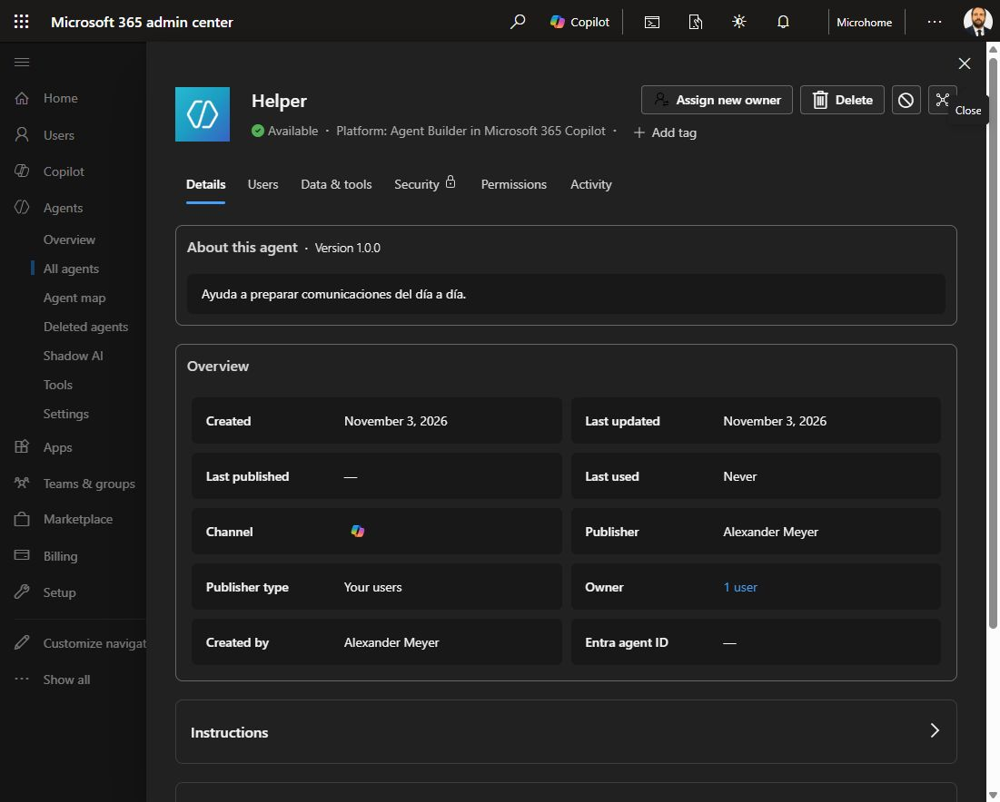

# 3. Inspect the inventory and controls

## Reproducible review

1. Sign in to the Microsoft 365 admin center with the authorized administrator. Confirm the account and tenant.
2. Open **Agents / All agents / Registry**.
3. Locate the lab agent. Match its identifier and creator with the maker record. Search names as a convenience, not as a unique key.
4. Inspect **Details**, **Users**, and **Data & tools**. Record the displayed owner count, creator, platform, status, instructions, sharing, configured knowledge, and tools.
5. Compare those fields with the intended recipe. Separate native capabilities from configured tools.
6. Record which administrative actions are visible, which are enabled, and which you actually execute.

*Observed November 3, 2026. The pilot's administrative details show its platform, publisher, creator, owner count, dates, and available actions. The capture shows the actual lab interface. It does not demonstrate control enforcement.*

## Corrections to discuss

| Finding | Proposed decision | Evidence needed |
|---|---|---|
| Ambiguous name | Use a descriptive name and record purpose | Updated maker view and matching ID |
| Overlapping purpose | Retain, consolidate, or retire after comparing requirements | Instructions, owner decision, dependencies |
| Missing accountable business owner | Assign accountability in the review record | Named person accepts responsibility |
| Unneeded knowledge source | Remove the source and retest | Saved configuration and a relevant test |
| Unsafe agent | Consider a scoped block | Before/after status and maker-side enforcement test |

Technical ownership and business accountability may differ. A nonzero owner count answers only part of the review.

## Optional blocking experiment: pending

Use only a disposable agent whose identifier is in the lab manifest. Preserve its configuration and establish a successful baseline interaction. Review the **Block** confirmation, apply the change only within the lab's agreed scope, record the administrative result, and test a fresh maker interaction. Allow for propagation and capture the actual outcome. If restoring access, use the approved administrative process and verify the restored state and interaction.

In our initial inspection, we opened and cancelled the block dialog. We did not execute blocking or restoration. Its generic explanation referenced Entra identity, while this agent's Entra agent ID field was blank. We therefore record the action as available in the interface, with its effective behavior still pending.

Do not infer universal control coverage from this one Agent Builder agent. Do not enable a trial, billing policy, or additional platform connection merely because a prompt offers it.

