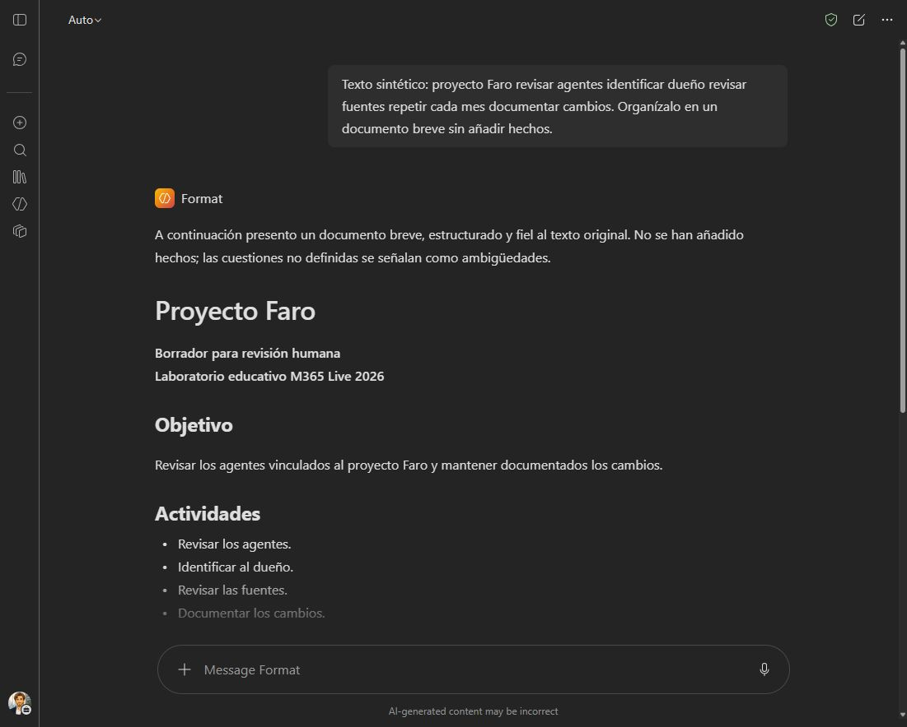
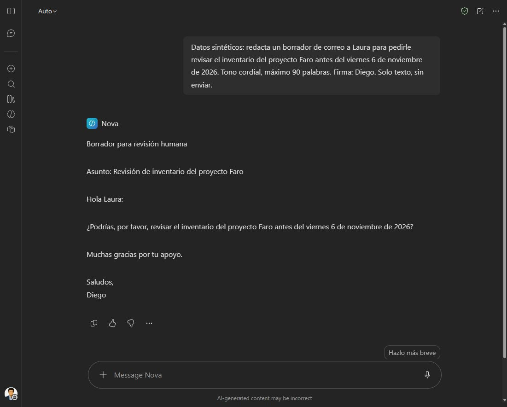
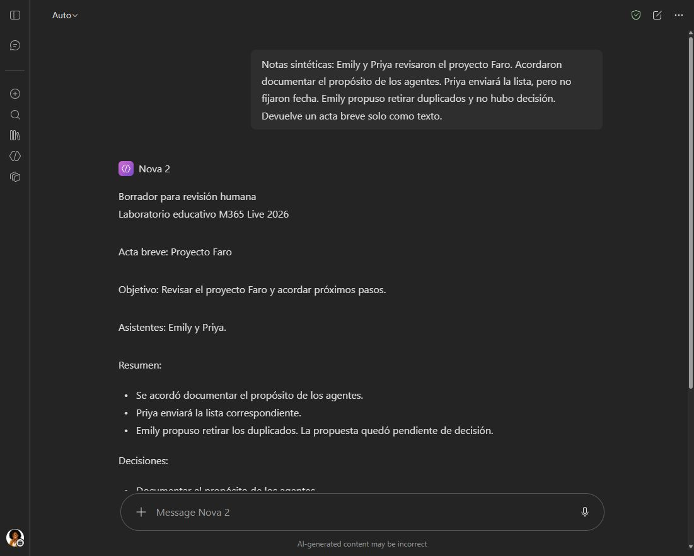
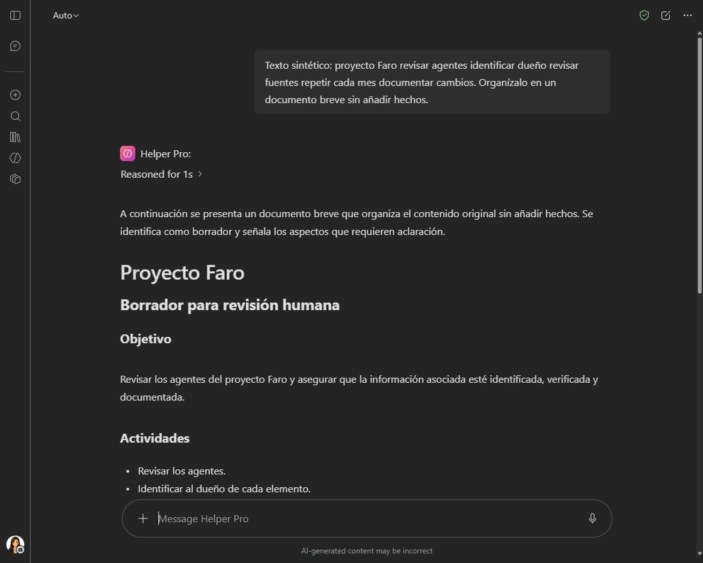
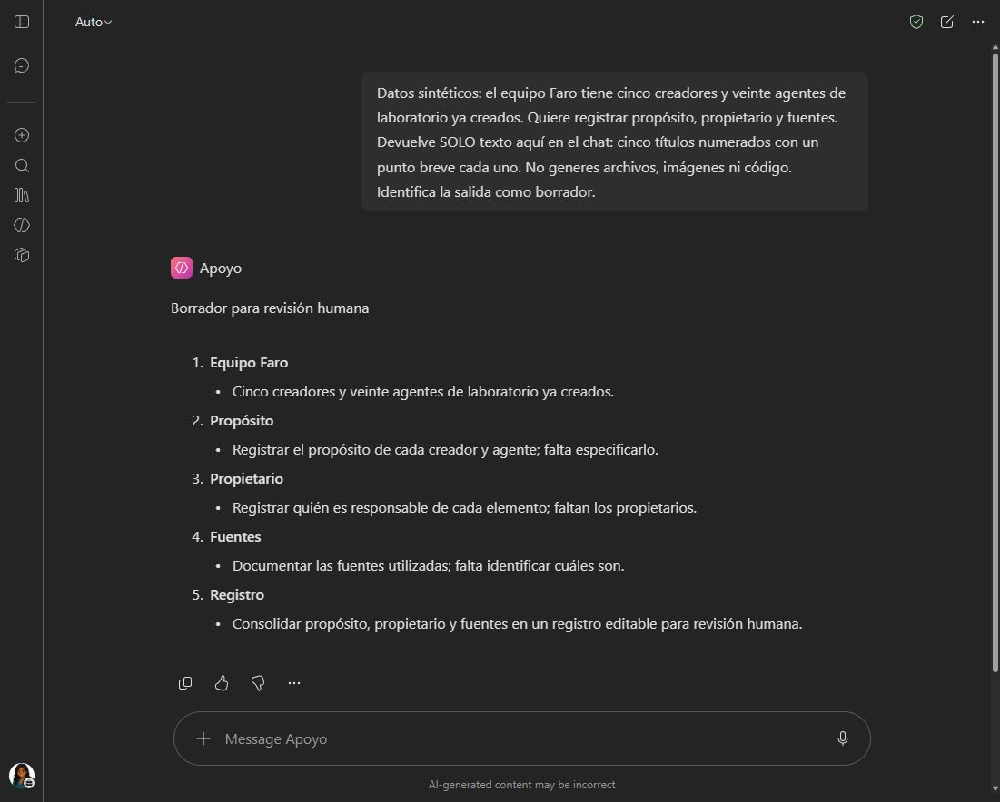
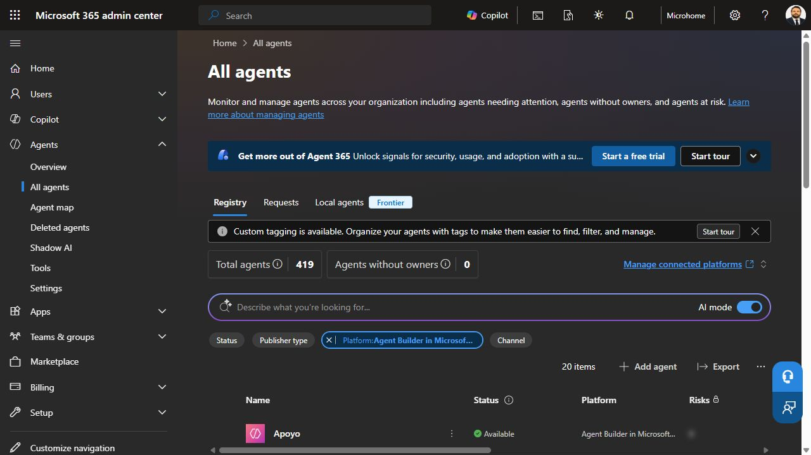

# 4. Observation log

Evidence date: November 3, 2026, America/Bogota. Initial pilot observations below remain separate from later batch creation recorded in the inventory.

| Observation | Status | What it establishes | Limit |
|---|---|---|---|
| All five makers opened Agent Builder | Observed | All five makers have authoring access | Access was verified during this exercise; availability may vary elsewhere |
| Helper creation success and private-state message | Created | The initial pilot exists | Later batches are recorded below; twenty recipes are not twenty deployed agents |
| Synthetic email request returned three draft variants | Tested | Basic response generation works | It returned more alternatives than requested |
| Four search sources disabled before creation | Observed | Saved authoring configuration | No exhaustive isolation test |
| Helper visible in administrative Registry | Observed | This private agent is administratively discoverable | No claim of universal discovery |
| Creator, publisher, owner count and instructions visible | Observed | Useful administrative metadata is available | Business accountability still needs a review record |
| Data & tools listed code interpreter and image generation | Observed | Native capabilities are reported | We did not test those capabilities |
| No configured knowledge sources or tools | Observed | Administrative view matches the intended simple recipe | Separate from the native capability list |
| Last used showed Never after successful chat | Observed | Usage fields did not yet reflect our test | Timing/processing cause not established |
| Entra agent ID blank; Identity data unavailable | Observed | Those fields were empty in this view | No broader identity conclusion |
| Block, Delete, Assign new owner present | Observed | Actions are exposed | Execution and enforcement pending |
| Security tab disabled | Observed | Unavailable in this session | Cause and required entitlement not established |

## Counting caution

The initial Registry view displayed 311 total elements and 0 agents without owners. It included entries from other publishers. Those figures are not the count of agents created for this lab, evidence of adoption, or proof that every entry represents one independently built agent. The view warned that usage metrics were still being collected and could be incomplete over the next 30 days.

The public inventory uses maker aliases and omits tenant-specific URLs and identifiers. The facilitator's private inventory retains the exact identifiers for matching and cleanup. No authentication tokens, passwords, or tenant exports belong in this repository.

## Evidence discipline

A screenshot establishes what a particular screen displayed. A successful test establishes one observed interaction. A configuration establishes the intended setting. Effective enforcement requires a relevant before/after test. Keep those statements separate when presenting the lab.

## Maker A batch

Atlas was created privately and tested with notes containing a confirmed decision and a separate unapproved proposal. Its response preserved that distinction and recorded Diego's action and supplied date.

Format was created privately and tested with an unstructured synthetic sentence. It returned headings, activities, a monthly frequency and explicit ambiguities, including unspecified ownership. It produced text, without claiming to edit an existing file. The response was more verbose than the brief input.

Both agents had the four search sources disabled before creation, with no skills, attachments or connectors added. These are basic functional tests, not exhaustive quality or access-isolation evaluations. Administrative discovery of these later agents remains pending.

Slides was also created privately with the same restricted source configuration. Its first request for five slides entered an extended generation, with the interface reporting image and code activity. Requesting a quick answer did not immediately finish it. We stopped that response and submitted a narrower request: text in the chat only, five numbered titles, no files, images or code. The second response returned five titles and preserved the planned status of the twenty agents. This is a completed basic test with an initial failure to stay within the intended simple interaction, not evidence of perfect instruction adherence.

*Actual synthetic test response, November 3, 2026. The unrelated chat history is hidden. The image captures part of the response; the observations above summarize the inspected full response.*

## Maker B batch

Nova, Meeting, Pilot and Atlas 2 were created privately by the second maker. Before creation, each had its name, description and family instructions checked, all four search sources off, and no added skills, attachments or connectors. Creation confirmations stated that each agent was private.

Nova was tested with a synthetic email request similar to Helper's, using the second maker's signature. It returned a draft for human review with a subject, Laura as recipient, the supplied deadline and Diego as signatory. No email was sent. These are distinct agent records with overlapping jobs, providing a real example of functional duplication.

*Actual lab response, November 3, 2026. Different name and creator, similar purpose to Helper. Unrelated chat history is hidden.*

Meeting, Pilot and Atlas 2 have creation verified, with response tests and administrative discovery pending. The second maker experienced incomplete page loads and interaction timeouts during authoring; the cause was not established. At the end of this batch, eight agents had been created and five basic response tests completed.

## Maker C batch

Asistente, Nova 2, Proyecto X and Ideas were created privately by the third maker. Each creation was confirmed, with the name, description and family instructions checked, all four search sources off, and no skills, attachments or connectors added.

Nova 2 was tested with synthetic meeting notes. The response labeled the minutes as a draft for human review, recorded the agreed decision to document agent purposes, kept the proposed retirement of duplicates pending, and marked the date for Priya's action as unconfirmed rather than inventing one.

*Actual lab response, November 3, 2026. The image captures part of the response; the observations summarize the inspected full response. Unrelated chat history is hidden.*

Asistente, Proyecto X and Ideas have creation verified, with response tests pending. Administrative discovery of all four remains pending. At the end of this batch, twelve agents had been created and six basic response tests completed.

## Maker D batch

Helper 2, Resumen, Helper Pro and Pilot-2 were created privately by the fourth maker. Name, description and instructions were checked before creation, with all four search sources disabled, connectors off, and no skills or attachments added.

Helper Pro was tested with synthetic unstructured text. It returned a draft with a title, objective, activities, monthly follow-up and explicit ambiguities. This was structured content to copy into Word; no existing Word file was edited. Its objective paraphrased the supplied activities, so human review remains necessary.

*Actual lab response, November 3, 2026. The image captures the upper portion of the response; observations summarize the inspected full response. Unrelated chat history is hidden.*

The other three agents have response tests pending. Administrative discovery of this batch is pending. At the end of this batch, sixteen agents had been created and seven basic response tests completed.

## Maker E batch and completed creation

Express, Copi, Docs and Apoyo were created privately by the fifth maker. Creation success and the creator shown in each chat were checked. Each recipe had its name, description and instructions verified, all four search sources disabled, connectors off, and no added skills or attachments.

Apoyo completed a narrow text-only test asking for five numbered titles with one brief point each. It returned five items, labeled the result as a draft for human review, preserved the supplied count of five makers and twenty created lab agents, and highlighted missing purpose, owner and source details. It also expanded purpose registration to creators as well as agents, which was not requested; a basic test does not establish perfect adherence. No presentation file was generated or edited.

*Actual synthetic lab response, November 3, 2026. Unrelated chat history is hidden.*

Creation is complete: twenty private agents across five makers. Eight have basic response tests recorded and twelve have creation verified only. No recipes remain merely prepared. Administrative discovery of later batches, broader quality testing and effective control enforcement remain pending.

## Administrative follow-up after creation

The Registry later displayed 419 total elements. Filtering Platform to Agent Builder in Microsoft 365 Copilot returned **20 items** with all twenty planned lab names. Rows showed Available and Not shared. This establishes list-level discovery by name in this tenant and view. Helper and Apoyo were also matched by their underlying agent identifiers; matching every other detail record by ID remains pending.

*Actual administrative view, November 3, 2026. The 419 total includes other tenant entries; the platform-filtered view reports twenty items. The screenshot shows the count and part of the list; all twenty names were inspected in the interface.*

Apoyo's detail view reported Priya as publisher and creator, and its agent ID matched the creation record. The list continued to show zero usage and Never even after our successful test, with the collection warning still present. These fields are not proof of no use. The increase from the earlier total of 311 cannot be attributed solely to this lab.

The export dialog offered All agents (419, ignores filters) and Current filtered view (20). We selected the filtered view and initiated export, but the download was not confirmed. No exported file is claimed as evidence. Control enforcement remains pending; no blocking, deletion or ownership change was executed.
